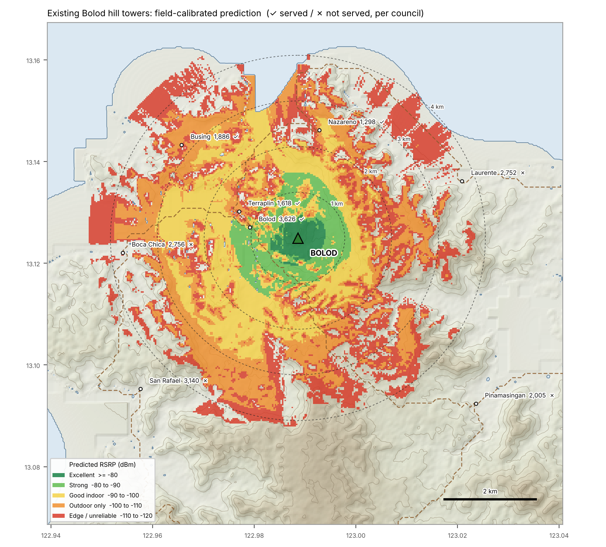
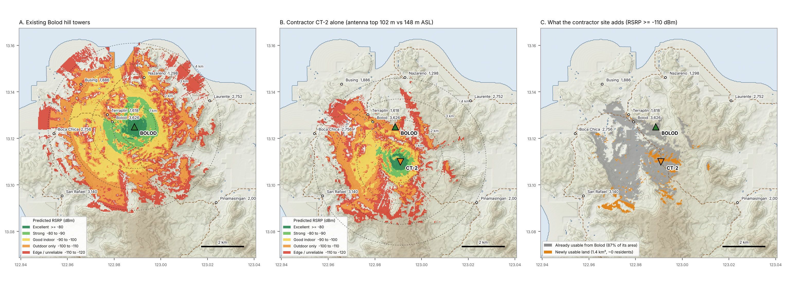
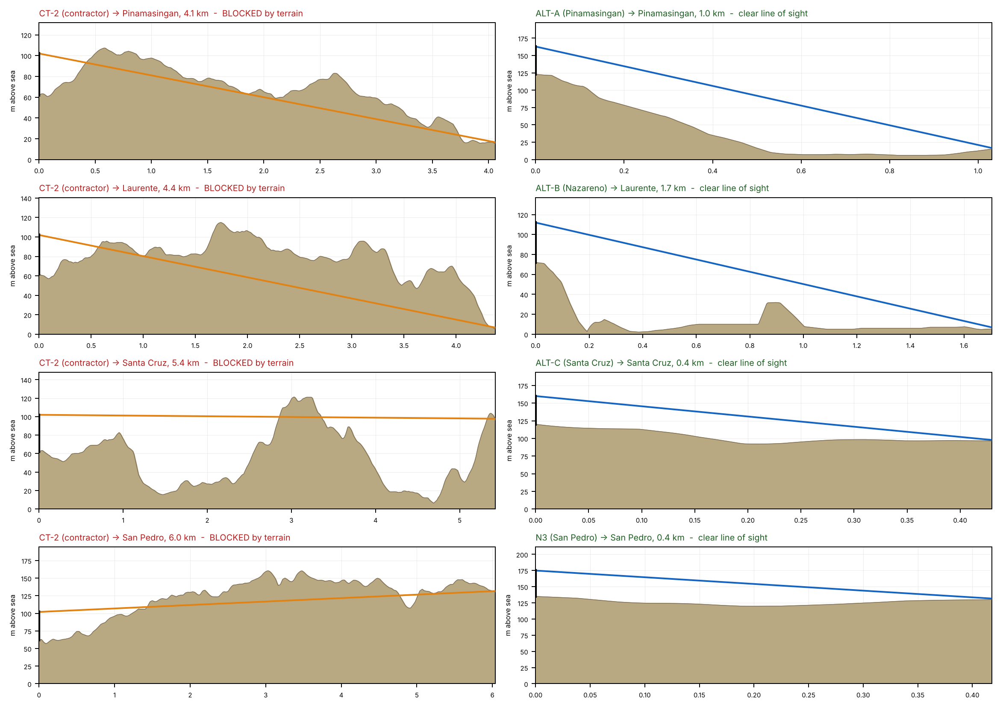

# 1. Coverage Overlap & Terrain Critique — Contractor's "Deeper Bolod / Pinamasingan Road" Site

**Prepared for:** Sangguniang Bayan of San Pascual, Masbate (Technical Advisor's review), Revision 2
**Question:** Does the proposed tower near the Pinamasingan Road in deeper Barangay Bolod extend service to the 18 barangays the existing Bolod hill towers cannot reach?
**Short answer:** No. **75–94 % of its coverage is already covered by the existing Bolod hill towers.** It adds **zero** residents of the unserved barangays, in every location scenario we tested, with a 30, 40 or 45 m mast (at most 15 people at 60 m).

> **Revision 2.** The first version over‑predicted range: it showed Bolod reaching parts of Laurente and signal running 10 km or more. The model is now calibrated to the council's field facts:
> - Bolod hill serves Bolod, Terraplin, Nazareno and Busing, and **not Laurente**.
> - Usable signal ends at **about 3–4 km**.
>
> The maps now show graded signal strength (RSRP classes) instead of a single flat fill. The conclusion is unchanged and stronger.

---

## 1.1 The population at stake

| | Residents (2020 Census) | Share |
|---|---:|---:|
| Total, 22 barangays | **44,449** | 100 % |
| Served today by Bolod hill (Bolod Pob., Terraplin/port, Nazareno, Busing) | 8,428 | 19 % |
| **Not served (18 barangays)** | **36,021** | **81 %** |

## 1.2 How well the model matches the field

| Barangay | km from towers | Field report | Predicted usable (≥ −110 dBm) | Predicted indoor (≥ −100 dBm) |
|---|---:|---|---:|---:|
| Bolod (Pob.) | 1.1 | Served | 87 % | 72 % |
| Terraplin | 1.4 | Served | 77 % | 47 % |
| Nazareno | 2.4 | Served | 55 % | 18 % |
| Busing | 3.2 | Served | 64 % | 9 % |
| Boca Chica | 3.8 | Not served | 17 % (eastern edge) | 0 % |
| **Laurente** | 3.7 | **Not served** | **1 %** | 0 % |
| Pinamasingan | 5.3 | Not served | 0 % | 0 % |
| San Rafael | 4.7 | Not served | 0 % | 0 % |

Median usable range over land is **3.2 km**; in most directions it ends between 2.8 and 3.5 km. A spur rising about 41 m above the radio path blocks Laurente.

## 1.3 Where the contractor's site sits

Exact coordinates were not in the packet we reviewed. We therefore modelled three plausible spots on the Poblacion → Pinamasingan road inside Bolod:

| Scenario | Lat, Lon | Ground | Antenna top @ 40 m | From towers | Area already covered by Bolod | Unserved residents added (30 / 45 / 60 m mast) |
|---|---|---:|---:|---:|---:|---:|
| CT‑1 | 13.1158, 122.9892 | 60 m | 100 m ASL | 1.0 km | 94 % | 0 / 0 / 0 |
| CT‑2 | 13.1100, 122.9908 | 62 m | 102 m ASL | 1.7 km | 87 % | 0 / 0 / 0 |
| CT‑3 | 13.1067, 122.9933 | 73 m | 113 m ASL | 2.1 km | 75 % | 0 / 0 / 15 |
| **Existing Bolod hill** | 13.1250, 122.9886 | **108 m** | **148 m ASL** | — | — | — |

> **The central fact:** the new antennas would sit **35–48 m lower than the antennas already on Bolod hill**, only 1–2 km away. Whatever terrain blocks Bolod also blocks them. With a 3–4 km reach, they also cannot get further out than Bolod already does.

Panel C shows the only land CT‑2 adds that Bolod does not already cover: **1.4 km² of slopes and gullies** south of the towers, with no barangay centre in it.

## 1.4 Why the terrain defeats it

| From CT‑2 to… | Distance | Result |
|---|---:|---|
| Pinamasingan (2,005) | 4.1 km | **Blocked** by a 105 m spur 0.6 km from the site |
| Laurente (2,752) | 4.4 km | **Blocked** by 3 km of hills up to 115 m |
| Santa Cruz (1,945) | 5.4 km | Beyond reach, and behind the central ridge |
| San Pedro (3,232) | 6.0 km | **Blocked** by the 160 m central ridge |

From the nearest proposed ridge site, each of these has clear line of sight (right column).

## 1.5 What this site is actually good for

The location optimises for road frontage, grid power, a 1–2 km backhaul hop and, at most, **capacity offload** in the poblacion. None of that serves the 36,021 unserved residents.

If the real purpose is capacity, or bringing in a second operator, **co‑location on the existing Bolod hill towers** delivers the same footprint without a new structure (DICT co‑location policy).

## 1.6 Verdict for the record

> *"The proposed site at deeper Bolod / Pinamasingan Road duplicates the existing Bolod hill coverage (75–94 % overlap). Its antennas would sit 35–48 m below the existing ones, and signal here reaches only 3–4 km. It therefore adds no service to any of the 18 unserved barangays. As proposed, it is a capacity or co‑location case, not a coverage‑extension case."*
