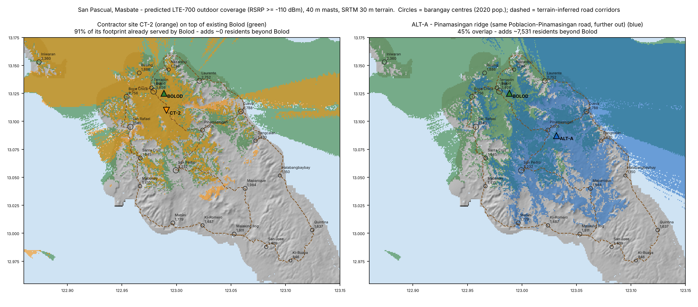

# 1. Coverage Overlap & Terrain Critique — Contractor's "Deeper Bolod / Pinamasingan Road" Site

**Prepared for:** Sangguniang Bayan of San Pascual, Masbate (Technical Advisor's review)
**Question:** Does the proposed new tower near the Pinamasingan Road in deeper Barangay Bolod extend service to the 18 barangays the existing Bolod hill towers cannot reach?
**Short answer:** No. In the terrain model, **84–94 % of its coverage footprint is already covered by the existing Bolod hill towers**. It adds **effectively zero (0–43) residents** who are not already within reach of the Bolod signal. It cannot clear the inland ridges that block San Pedro, Pinamasingan, Mapanique, Ki‑Romero and everything further south.

---

## 1.1 The population at stake

| | Residents (2020 Census) | Share |
|---|---:|---:|
| Total, 22 barangays | **44,449** | 100 % |
| Served today by Bolod hill (Bolod Pob., Terraplin/port, Nazareno, Busing) | 8,428 | 19 % |
| **Not served (18 barangays)** | **36,021** | **81 %** |

Barangay‑level figures are in [`data/barangays.csv`](../data/barangays.csv). The 2024 POPCEN municipal total is 44,641 (+0.4 %), so the 2020 split is used throughout.

## 1.2 Where the contractor's site sits

The exact coordinates were not in the application packet we reviewed. The site was therefore modelled at three plausible spots on the Poblacion → Pinamasingan road inside Bolod (terrain‑inferred alignment, see [methodology](05_methodology_and_limitations.md)):

| Scenario | Lat, Lon | Ground (m ASL) | Distance from existing towers | Antenna top @ 40 m mast |
|---|---|---:|---:|---:|
| CT‑1 | 13.1158 N, 122.9892 E | 60 | 1.0 km | ~100 m ASL |
| CT‑2 | 13.1100 N, 122.9908 E | 62 | 1.7 km | ~102 m ASL |
| CT‑3 | 13.1067 N, 122.9933 E | 73 | 2.1 km | ~113 m ASL |
| **Existing Bolod hill towers** | 13.1250 N, 122.9886 E | **108** | — | **~148 m ASL** |

> **The central fact:** the new antennas would sit **35–48 m *lower* than the antennas already on Bolod hill**, only 1–2 km away. A lower antenna next to a higher one cannot see over terrain that the higher one cannot see over. Its "coverage" is necessarily a subset of the existing towers' footprint.

## 1.3 Model results (LTE‑700, 40 m mast, SRTM 30 m terrain)

| Metric | CT‑1 | CT‑2 | CT‑3 |
|---|---:|---:|---:|
| Share of its served land already served by Bolod | **94 %** | **91 %** | **84 %** |
| Unserved‑barangay residents inside its footprint (outdoor ≥ −110 dBm) | 5,739 | 4,925 | 5,134 |
| …of whom Bolod's signal **does not already** reach | **22** | **0** | **43** |
| Same, indoor grade (≥ −100 dBm) | 0 | 0 | 0 |
| Mast‑height sensitivity (residents in footprint at 30 / 45 / 60 m) | 4.7k / 6.2k / 7.2k | 4.3k / 5.4k / 6.9k | 4.1k / 5.8k / 7.1k |

What the ~5,000 "reached" residents actually are: fringe signal in **Boca Chica, Iniwaran (island), Santa Cruz and Cueva**. The Bolod hill towers already throw the same weak fringe into those places. Residents there still report no usable service, because at −100 to −110 dBm a phone drops indoors. The contractor's site lands in the same marginal band and **does not lift a single additional barangay to indoor‑grade service**.

Raising the mast does not rescue it. Even at 60 m, CT‑2's antenna top (~122 m ASL) is still below the existing Bolod antennas.

*Left: contractor CT‑2 (orange) over the existing Bolod footprint (green), almost entirely overlapping. Right: ALT‑A, a ridge on the same road ~5 km further out, which opens the interior.*

## 1.4 Why the terrain defeats it

San Pascual's populated interior and south sit behind a **120–200 m spine of hills** running from the Santa Cruz–San Pedro massif (SRTM summit ~197 m at 13.041 N, 122.989 E) south‑east through Mapanique to the Ki‑Buaya ridge. The contractor's site is in the **low corridor north of that spine**, at 60–73 m.

Cross‑sections from CT‑2 (left column) versus a ridge alternative (right column):

| From CT‑2 to… | Distance | Result | Controlling obstacle |
|---|---:|---|---|
| San Pedro (3,232) | 6.0 km | **Blocked** | Ridge 140–160 m at 2.5–4.5 km, ~40 m above the radio path |
| Pinamasingan (2,005) | 4.1 km | **Blocked** | Spur ~105 m at 0.6 km, right beside the site |
| Mapanique (1,984) | 11.0 km | **Blocked** | Multiple ridges; 130 m peak at 7 km |
| Ki‑Romero (1,487) | — | **Blocked** | Central massif |

Every one of these barangays has **clear line of sight** from at least one of the ridge alternatives in section 2.

## 1.5 What this site is actually good for

Read charitably, the contractor's location optimises for:

1. **Road frontage**: zero access‑road cost.
2. **Grid power**: the poblacion distribution line is nearby.
3. **A 1–2 km backhaul hop** to Bolod, possibly fibre or an E‑band link.
4. **Capacity offload** for the poblacion/port, *if* the Bolod sectors are congested.

None of these serves the 36,021 unserved residents. If the real purpose is **(a) capacity** or **(b) bringing a second operator** into town, the right instrument is a **co‑location on the existing Bolod hill towers** (DICT common‑tower / co‑location policy). That gives the same footprint with no new structure. A new greenfield tower is justified only if it **extends** coverage.

## 1.6 Verdict for the record

> *"The proposed site at deeper Bolod / Pinamasingan Road duplicates the existing Bolod hill coverage (84–94 % overlap). Because its antennas would sit 35–48 m below the existing ones, it does not clear the inland ridges and adds no material service to the 36,021 residents of the 18 unserved barangays. As proposed, it is a capacity or co‑location case, not a coverage‑extension case."*
