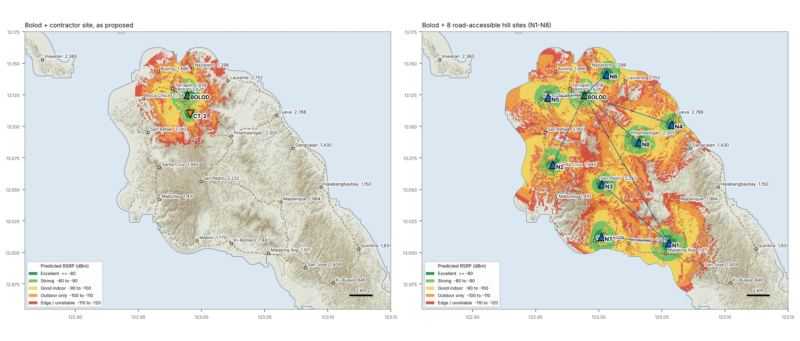
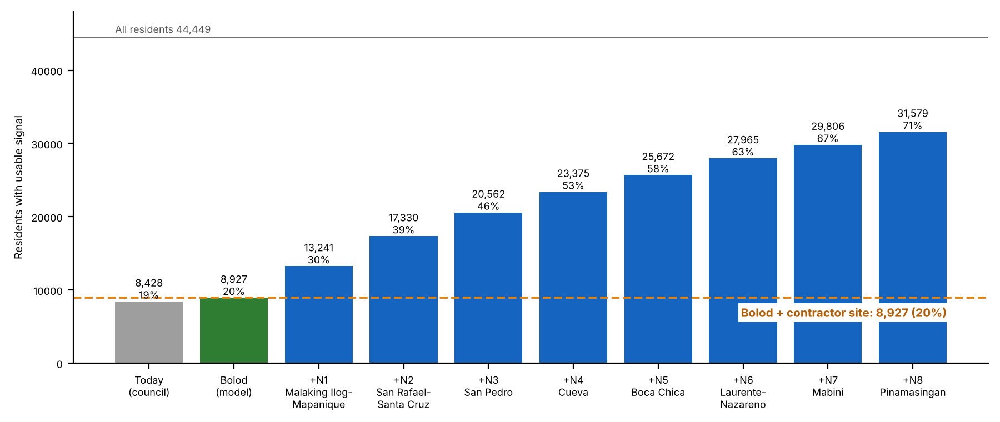

# 2. Better Compromises Along the Road — Road‑Accessible Ridge Sites (Revision 2)

With a usable reach of only **3–4 km**, a tower has to stand close to the people it serves. Every site below meets three tests:

- **Close to people:** high ground near an unserved barangay.
- **Road access:** within **1 km of a road**.
- **Backhaul:** a microwave path to Bolod clearing 0.6 F1 at k = 4/3 and 0.3 F1 at k = 2/3 at 15 GHz, with **≤ 45 m masts at both ends**.

We screened 93 road‑accessible hilltops. The full list is in [`results/candidates.csv`](../results/candidates.csv); all numbers are in [`results/review.json`](../results/review.json).

## 2.1 Five ridge sites, one per direction

| ID | Site | Lat, Lon | Ground | Road spur | Hop to Bolod | Masts (15 GHz) | **New residents** usable / indoor | Barangays lifted (share of settled area) |
|---|---|---|---:|---:|---:|---:|---:|---|
| **ALT‑A** | **Pinamasingan ridge**: same Poblacion–Pinamasingan road, further out | 13.0875, 123.0317 | 123 m | 723 m | 6.3 km | 40 m | **2,615 / 1,947** | Pinamasingan 100 %, Cueva 22 % |
| **ALT‑B** | **Laurente–Nazareno ridge**: north‑coast road | 13.1414, 123.0061 | 72 m | 971 m | 2.6 km | 20 m | **2,293 / 1,914** | Laurente 85 %, Nazareno 38 % |
| **ALT‑C** | **San Rafael–Santa Cruz ridge**: on the west‑coast road | 13.0697, 122.9636 | 120 m | 43 m | 6.7 km | 15 m | **4,089 / 2,401** | Santa Cruz 99 %, San Rafael 62 %, Mabuhay 14 % |
| **ALT‑D** | **Malaking Ilog–Mapanique ridge**: inland road | 13.0075, 123.0556 | 153 m | 985 m | 15.0 km | 35 m (40 m @ 7 GHz) | **4,314 / 2,323** | Malaking Ilog 99 %, Mapanique 64 %, Ki‑Romero 62 %, San Jose 16 % |
| **ALT‑E** | **Cueva ridge**: Poblacion–Quintina road | 13.1017, 123.0578 | 62 m | 410 m | 7.9 km | 35 m | **2,813 / 2,069** | Cueva 91 %, Pinamasingan 12 % |
| *CT‑2* | *Contractor, deeper Bolod* | *13.1100, 122.9908* | *62 m* | *0* | *1.7 km* | — | ***0 / 0*** | *none* |

One map per site: `results/fig_alt-a.png` … `fig_alt-e.png`. Microwave profiles: `results/fig_mw_profiles.png`.

## 2.2 Network plan: no single tower can do it

Sites were added one at a time, each chosen for the most new residents and each needing a microwave hop to Bolod or to an earlier site:

| # | Site | Lat, Lon | Ground | Spur | Backhaul via | Adds | Municipality within service |
|---|---|---|---:|---:|---|---:|---:|
| — | Bolod today (model) | | | | | | 8,927 (20 %) |
| N1 | Malaking Ilog–Mapanique ridge (ALT‑D) | 13.0075, 123.0556 | 153 m | 985 m | Bolod, 15.0 km | +4,314 | 13,241 (30 %) |
| N2 | San Rafael–Santa Cruz ridge (ALT‑C) | 13.0697, 122.9636 | 120 m | 43 m | Bolod, 6.7 km | +4,089 | 17,330 (39 %) |
| N3 | San Pedro hill | 13.0542, 123.0025 | 135 m | 206 m | N1, 7.8 km | +3,232 | 20,562 (46 %) |
| N4 | Cueva ridge (ALT‑E) | 13.1017, 123.0578 | 62 m | 410 m | Bolod, 7.9 km | +2,813 | 23,375 (53 %) |
| N5 | Boca Chica hill | 13.1231, 122.9600 | 64 m | 358 m | Bolod, 3.1 km | +2,297 | 25,672 (58 %) |
| N6 | Laurente–Nazareno ridge (ALT‑B) | 13.1414, 123.0061 | 72 m | 971 m | Bolod, 2.6 km | +2,293 | 27,965 (63 %) |
| N7 | Mabini hill | 13.0125, 123.0022 | 100 m | 707 m | N1, 5.8 km | +1,841 | 29,806 (67 %) |
| N8 | Pinamasingan ridge (ALT‑A) | 13.0875, 123.0317 | 123 m | 723 m | Bolod, 6.3 km | +1,773 | 31,579 (71 %) |
| *—* | *Bolod + contractor site* | | | | | *+0* | *8,927 (20 %)* |

## 2.3 Recommended positions for the council

1. **Phase 1, the ask:** ALT‑D (Malaking Ilog–Mapanique) and ALT‑C (San Rafael–Santa Cruz).
   - **+8,403 residents**; service rises from 20 % to **39 %**.
   - ALT‑C sits on the west‑coast road with the easiest backhaul on the island (15 m masts).
   - ALT‑D needs a 15 km link: specify 7/8 GHz, not 15/18 GHz, in rain zone P.
2. **Minimum compromise if the contractor will only build on its own road:** ALT‑A Pinamasingan ridge (+2,615), or ALT‑E Cueva ridge on the Poblacion–Quintina road (+2,813). Either beats the proposed spot's zero.
3. **Laurente specifically:** ALT‑B gives Laurente 85 % usable coverage with a cheap 2.6 km hop.
4. **Roadmap:** ask for the eight‑site plan above, which reaches **71 %** of residents.

## 2.4 Board matrix: four metrics

Scores run from 1 (poor) to 5 (excellent).

| Site | ① Population covered (new) | ② Backhaul to Bolod | ③ Power / road | ④ Commercial viability (indicative) | Verdict |
|---|---|---|---|---|---|
| **CT** Contractor | **1** – 0 | **5** – 1–2 km | **5** – on road, near grid | **1** – no new subscribers | **Reject as coverage project** |
| **ALT‑A** Pinamasingan | 3 – 2,615 | 4 – 6.3 km, 40 m | 3 – 723 m spur | 3 – ₱1.6–2.4 M/yr | Minimum compromise on contractor's road |
| **ALT‑B** Laurente–Nazareno | 3 – 2,293 | 5 – 2.6 km, 20 m | 3 – 971 m spur | 3 – ₱1.4–2.1 M/yr | Laurente fix, cheap hop |
| **ALT‑C** San Rafael–Santa Cruz | 5 – 4,089 | 5 – 6.7 km, 15 m | 5 – on the road | 5 – ₱2.5–3.7 M/yr | **Phase 1** |
| **ALT‑D** Malaking Ilog–Mapanique | 5 – 4,314 | 3 – 15 km, 35–40 m | 3 – 985 m spur, solar‑hybrid | 4 – ₱2.6–3.9 M/yr | **Phase 1, best single site** |
| **ALT‑E** Cueva | 3 – 2,813 | 4 – 7.9 km, 35 m | 4 – 410 m spur | 3 – ₱1.7–2.5 M/yr | Phase 2 |

**Commercial lens.** These figures are indicative, to be replaced with operator data.

- **Revenue:** ₱600–900 per newly covered resident per year.
- **Capex:** a 40 m greenfield with microwave costs ₱10–15 M, plus ₱3–6 M for a hilltop spur and solar‑hybrid power.
- **Payback:** a single ridge site pays back in roughly 4–7 years.
- **The contractor's site:** no new revenue; it only moves traffic off Bolod.

A 3–4 km reach means full coverage depends on shared infrastructure: multi‑operator tenancy, DICT common‑tower and connectivity programmes, and LGU help with land and access roads.

## 2.5 Unconstrained benchmark

Ignoring the 1 km road rule, the three strongest hilltops reach 21,256 residents. The best road‑accessible three‑site package reaches 20,143. **The road constraint costs almost nothing.** See [`results/selection.json`](../results/selection.json).

## 2.6 Before any site is final

Each of these needs confirming before it is final:

- **Site walk:** GPS fix, obstruction photo toward the parent site, land ownership.
- **Real road and power‑line alignment:** ours is inferred from terrain.
- **The operator's band:** a 700/850 MHz layer would reach further than the 1800 MHz‑like 3–4 km seen today.
