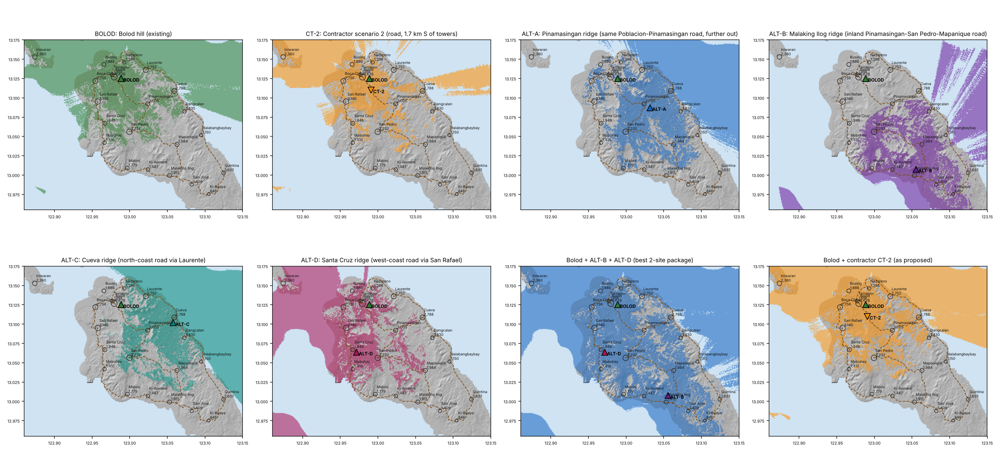

# 2. Better Compromises Along the Road — Road‑Accessible Ridge Alternatives

**Brief:** keep what the contractor wants (road access, a feasible power run, microwave line‑of‑sight to Bolod) but move to high ground that actually reaches the unserved barangays.

**Search method:** all 201 SRTM hilltops ≥ 60 m in San Pascual were screened. A site survived only if it met all three tests:

- **Road:** within **1 km** of a road corridor (≤ 1 km access spur).
- **Backhaul:** a microwave path to Bolod hill that passes **0.6 F1 @ k=4/3 and 0.3 F1 @ k=2/3**, with **≤ 45 m masts at both ends**, including +10 m for canopy.
- **Coverage:** scored on unserved residents served beyond what Bolod already reaches.

71 hilltops passed. The best one on each road corridor is below. The ranked list of all 201 is in [`results/candidates.csv`](../results/candidates.csv).

## 2.1 The four road‑accessible ridge sites

| ID | Site | Lat, Lon | Ground | Road spur | Hop to Bolod | Masts needed (15 GHz) | Unserved residents reached | **Net new beyond Bolod** (outdoor / indoor) | Overlap with Bolod |
|---|---|---|---:|---:|---:|---:|---:|---:|---:|
| **ALT‑A** | **Pinamasingan ridge**: same Poblacion–Pinamasingan road, ~5 km past the contractor's spot | 13.0872 N, 123.0317 E | 123 m | 0.7 km | 6.3 km | 40 m / 40 m | 11,497 | **7,531 / 5,153** | 45 % |
| **ALT‑B** | **Malaking Ilog–Mapanique ridge**: inland Pinamasingan–San Pedro–Mapanique road | 13.0075 N, 123.0556 E | 153 m | 1.0 km | 15.0 km | 35 m / 35 m (40 m at 7 GHz) | 12,174 | **11,622 / 10,046** | 12 % |
| **ALT‑C** | **Cueva ridge**: north‑coast road via Laurente | 13.1017 N, 123.0578 E | 62 m | 0.4 km | 7.9 km | 35 m / 35 m | 9,285 | **5,444 / 4,933** | 43 % |
| **ALT‑D** | **Santa Cruz ridge**: west‑coast road via San Rafael | 13.0636 N, 122.9717 E | 140 m | 0.6 km | 7.1 km | 15 m / 15 m | 11,147 | **6,555 / 4,982** | 58 % |
| *CT‑2* | *Contractor (for reference)* | *13.1100 N, 122.9908 E* | *62 m* | *0* | *1.7 km* | *trivial* | *4,925* | ***0 / 0*** | *91 %* |

Barangays each site lifts to service (share of the settlement area at ≥ −110 dBm):

- **ALT‑A:** Pinamasingan 100 %, San Pedro 93 %, Cueva 81 %, Mapanique 54 %, Dangcalan 44 %, Mabini 41 %
- **ALT‑B:** Mapanique 100 %, Malaking Ilog 100 %, San Pedro 99 %, Ki‑Romero 93 %, San Jose 81 %, Ki‑Buaya 74 %, Mabini 53 %, Dangcalan 50 %
- **ALT‑C:** Cueva 99 %, San Pedro 75 %, Pinamasingan 72 %, Laurente 63 %, Dangcalan 43 %
- **ALT‑D:** Santa Cruz 96 %, San Pedro 84 %, San Rafael 81 %, Mabuhay 65 %, Boca Chica 59 %

## 2.2 Recommended positions for the council

1. **Minimum acceptable compromise: ALT‑A, Pinamasingan ridge.** Same road the contractor already chose, about 5 km further out, plus a 0.7 km spur. It is still a single 6.3 km hop to Bolod (40 m masts). It brings **~7,500 net new residents (5,200 indoor‑grade)** against **zero** for the proposed spot. This is the easiest "yes" to put to the contractor.
2. **Best single site for the unserved: ALT‑B, Malaking Ilog–Mapanique ridge.** Largest gain (**~11,600 net, 10,000 indoor**) and only 12 % overlap with Bolod. It covers the whole southern belt. The trade‑off is a **15 km hop**: in ITU rain zone P, specify **7/8 GHz** (40 m masts) or an 11 GHz link with adaptive modulation, not 15/18 GHz. Power will likely need a solar‑hybrid system.
3. **Best two‑site package: ALT‑B + ALT‑D.** **15,268 net new residents.** With Bolod, about **28,600 of 44,449 (64 %)** are within service, against **~13,400 (30 %)** for Bolod plus the contractor's site. ALT‑D has the easiest backhaul on the island (15 m masts, 7.1 km).

| Package | Net new beyond Bolod | Municipality within service (with Bolod)* |
|---|---:|---:|
| Contractor CT‑2 | **0** | 13,353 (30 %) |
| ALT‑A only | 7,531 | 19,925 (45 %) |
| ALT‑B only | 11,622 | 20,602 (46 %) |
| ALT‑A + ALT‑B | 14,186 | 26,580 (60 %) |
| **ALT‑B + ALT‑D** | **15,268** | **28,557 (64 %)** |
| ALT‑B + ALT‑C + ALT‑D | 17,861 | 34,394 (77 %) |

\*Counts the 4 barangays the council considers served, plus each package's outdoor coverage of the other 18.

## 2.3 Board matrix: four metrics

Scores run from 1 (poor) to 5 (excellent). Population figures are 2020 Census residents (out of 44,449; 36,021 unserved).

| Site | ① Population covered (net new beyond Bolod) | ② Backhaul feasibility to Bolod | ③ Power / road accessibility | ④ Commercial viability | **Overall** |
|---|---|---|---|---|---|
| **CT – Contractor, deeper Bolod** | **1** – ~0 net (4.9–5.7k in overlapping fringe) | **5** – 1–2 km, trivial | **5** – on the road, near grid | **1** as a coverage site (no new subscribers); 3 if justified purely as capacity | **Reject as a coverage project** |
| **ALT‑A – Pinamasingan ridge** | **4** – 7.5k (5.2k indoor) | **4** – 6.3 km, 40 m both ends | **4** – 0.7 km spur off the same road; DPWH Pinamasingan road (FY2024) | **4** | **Minimum compromise** |
| **ALT‑B – Malaking Ilog–Mapanique ridge** | **5** – 11.6k (10.0k indoor) | **3** – 15 km; 7/8 GHz with 40 m masts | **3** – 1 km spur; remote; solar‑hybrid | **5** – largest captive unserved market | **Best single site** |
| **ALT‑C – Cueva ridge** | **3** – 5.4k (4.9k indoor) | **4** – 7.9 km, 35 m | **4** – 0.4 km off the coast road | **3** | Phase‑3 infill |
| **ALT‑D – Santa Cruz ridge** | **4** – 6.6k (5.0k indoor) | **5** – 7.1 km, 15 m masts | **4** – 0.6 km off the west‑coast road | **4** | **Best partner to ALT‑B** |

**Indicative commercial lens.** These assumptions are for discussion and should be replaced with the operator's own figures:

- **Revenue:** at a blended ₱600–900 per covered resident per year (rural Bicol mix of prepaid voice and data), ALT‑B's ~11.6k net residents mean **₱7–10 M/yr**. ALT‑A's 7.5k mean **₱4.5–6.8 M/yr**.
- **Contractor site:** almost no new revenue, because the residents in its footprint already sit inside the Bolod signal.
- **Capex:** a typical 40 m greenfield with microwave is **₱10–15 M**. A hilltop adds **₱3–6 M** for the access spur and solar‑hybrid power.
- **Payback:** about **2–3 years** for ALT‑A/ALT‑B. The contractor's site has none on coverage grounds.

## 2.4 Unconstrained benchmark (if road access were not a constraint)

Ignoring the 1 km road rule, the strongest hilltops are:

| Rank | Location | Ground | Unserved residents reached | Hop to Bolod |
|---|---|---:|---:|---:|
| 1 | Central massif, Santa Cruz / San Pedro / Mabuhay (13.0475 N, 122.9836 E) | 194 m | 15,310 | 8.6 km, 15 m masts |
| 2 | Dangcalan ridge (13.0700 N, 123.0769 E) | 127 m | 11,794 | 11.4 km, 15 m masts |
| 3 | Ki‑Buaya ridge (12.9892 N, 123.1072 E) | 186 m | 9,130 | 19.9 km, 45 m masts |

The three together reach **~33,600 of 44,449**. The road‑accessible ALT‑B + ALT‑C + ALT‑D package gets 34,400, so the road constraint costs almost nothing. **That is the core argument: the contractor does not have to give up road access to serve the interior.** See [`results/selection.json`](../results/selection.json).

## 2.5 Before any of these is final

- **Survey‑grade check:** have each ridge spot walked, with a GPS fix and an obstruction photo toward Bolod. SRTM is 30 m data with ±5–10 m vertical error.
- **Road reality check:** the corridor used here is inferred from terrain because no road file was available. Confirm actual road and power‑line alignments with the MPDO / MASELCO, or with an OSM or Google Earth trace, and re‑run `analysis/contractor_review.py`.
- **Land:** check lot ownership and lease availability on each ridge; municipal or barangay land helps.
